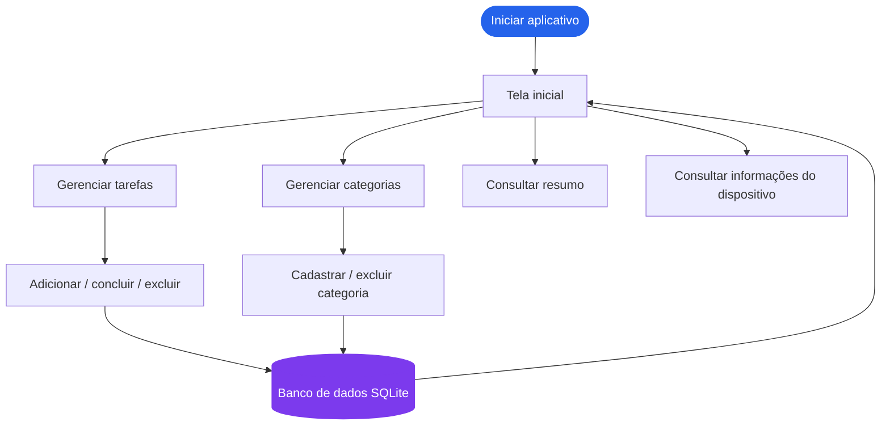

#  Lista de Tarefas

<div align="center">


<br/>


<br/>

**Um aplicativo mobile desenvolvido para tornar a organização de tarefas mais simples, prática e eficiente.**

[Funcionalidades](#-funcionalidades) •
[Tecnologias](#-tecnologias) •
[Instalação](#-como-executar-o-projeto) •
[Equipe](#-equipe-de-desenvolvimento)

</div>

---

## 📌 Sobre o projeto

O **Lista de Tarefas** é um aplicativo mobile desenvolvido com React Native e Expo, com o objetivo de auxiliar os usuários na organização de suas atividades diárias.

A aplicação permite cadastrar tarefas, organizá-las por categorias, acompanhar atividades concluídas e visualizar indicadores de progresso em uma interface intuitiva e moderna.

Além das funcionalidades tradicionais de gerenciamento, o projeto explora recursos importantes do desenvolvimento mobile, como persistência de dados com SQLite, funcionamento offline, navegação com Expo Router e integração com funcionalidades nativas utilizando Kotlin.

O desenvolvimento também contempla uma funcionalidade de sincronização simulada, com tratamento de tentativas e novas tentativas de envio.

### 🎯 Objetivo

Desenvolver uma aplicação mobile funcional que reúna organização, produtividade e armazenamento local, aplicando conceitos de desenvolvimento de software e tecnologias utilizadas no ecossistema React Native.

---

## 📱 Demonstração do aplicativo

As imagens a seguir devem ser substituídas por capturas reais das telas do aplicativo.

<div align="center">

### Tela inicial


*Visualização e gerenciamento das tarefas cadastradas.*

### Categorias


*Organização das tarefas por categorias personalizadas.*

### Resumo


*Acompanhamento das atividades e do progresso.*

### Sobre


*Informações sobre o aplicativo e o dispositivo.*

</div>

---

## ✨ Funcionalidades

O aplicativo conta com recursos voltados à organização e ao acompanhamento das atividades.

| Recurso | Descrição |
|---|---|
| 📝 Gerenciamento de tarefas | Cadastro, consulta e exclusão de tarefas. |
| ✅ Conclusão de atividades | Alteração entre tarefas pendentes e concluídas. |
| 📂 Categorias | Criação e gerenciamento de categorias. |
| 🔎 Pesquisa | Busca de tarefas cadastradas. |
| 🏷️ Filtros | Separação entre todas, pendentes e concluídas. |
| 📊 Resumo | Visualização de indicadores e progresso. |
| 💾 SQLite | Armazenamento local das informações. |
| 📡 Sincronização simulada | Demonstração de tentativas de sincronização e reenvio. |
| 📱 Integração nativa | Consulta de informações do dispositivo utilizando Kotlin. |
| 🔗 Deep Links | Acesso direto a tarefas específicas por meio de links. |

---

## 🛠️ Tecnologias utilizadas

As tecnologias foram escolhidas para desenvolver uma aplicação mobile organizada, funcional e com possibilidade de expansão.

| Tecnologia | Aplicação no projeto |
|---|---|
| React Native | Desenvolvimento da interface mobile. |
| Expo | Ambiente e ferramentas de desenvolvimento. |
| TypeScript | Tipagem e organização do código. |
| Expo Router | Navegação entre telas. |
| Expo SQLite | Persistência de dados local. |
| React Native Safe Area Context | Adaptação da interface às áreas seguras do dispositivo. |
| Kotlin | Desenvolvimento de funcionalidade nativa para informações do dispositivo. |

---

## ⚙️ Funcionamento da aplicação

### 1. Gerenciamento de tarefas

O usuário pode adicionar tarefas, consultar as atividades cadastradas, marcar tarefas como concluídas e excluir registros.

### 2. Organização por categorias

As categorias permitem agrupar atividades de acordo com suas necessidades, facilitando a visualização e a organização.

### 3. Acompanhamento do progresso

A tela de resumo apresenta informações sobre a quantidade de tarefas e o andamento das atividades.

### 4. Armazenamento local

O aplicativo utiliza SQLite para armazenar tarefas e categorias diretamente no dispositivo.

Isso permite consultar as informações mesmo quando não existe conexão com a internet.

### 5. Sincronização simulada

O projeto apresenta um mecanismo demonstrativo de sincronização, com novas tentativas de execução e intervalos entre elas.

> **Importante:** a sincronização é simulada. O projeto não realiza atualmente o envio dos dados para um servidor ou API externa.

### 6. Integração com Kotlin

Uma funcionalidade nativa foi desenvolvida em Kotlin para consultar informações do dispositivo Android, demonstrando a integração entre React Native e código nativo.

---

## 🔄 Fluxo de funcionamento



---

## 📁 Estrutura do projeto

A organização dos arquivos segue a separação entre telas, banco de dados e estilos.

```text
Lista/
│
├── src/
│   ├── app/
│   │   ├── _layout.tsx
│   │   ├── index.tsx
│   │   ├── categorias.tsx
│   │   ├── resumo.tsx
│   │   ├── sobre.tsx
│   │   └── item.tsx
│   │
│   ├── db/
│   │   └── db.ts
│   │
│   └── estilo.ts
│
├── assets/
│   └── imagens/
│
├── android/
│   └── ...
│
├── app.json
├── eas.json
├── package.json
├── tsconfig.json
└── README.md
```

*Observação: a estrutura é ilustrativa e deve ser ajustada conforme os diretórios e arquivos existentes no repositório.*

---

## 🚀 Como executar o projeto

Siga os passos abaixo para executar o aplicativo em seu ambiente de desenvolvimento.

### Pré-requisitos

Antes de iniciar, instale:

- [Node.js](https://nodejs.org/)
- [Git](https://git-scm.com/)
- [Visual Studio Code](https://code.visualstudio.com/)
- [Expo Go](https://expo.dev/go), caso queira testar em um dispositivo compatível.

### 1. Clone o repositório

Abra o terminal e execute:

```bash
git clone https://github.com/SEU-USUARIO/SEU-REPOSITORIO.git
```

### 2. Acesse a pasta

```bash
cd SEU-REPOSITORIO
```

### 3. Instale as dependências

```bash
npm install
```

### 4. Inicie o Expo

```bash
npx expo start
```

### 5. Execute no dispositivo

Após iniciar o projeto:

1. Abra o Expo Go no celular, quando estiver utilizando uma configuração compatível.
2. Conecte o celular e o computador à mesma rede Wi-Fi.
3. Escaneie o QR Code apresentado pelo Expo.
4. Aguarde o carregamento da aplicação.

> **Atenção:** o aplicativo possui integração nativa com Kotlin. Para testar essa funcionalidade, utilize uma development build ou uma compilação Android compatível. O Expo Go padrão não carrega módulos nativos personalizados.

---

## 📦 Como gerar o APK

Para gerar uma versão instalável do aplicativo Android, utilize o EAS Build.

### 1. Instale o EAS CLI

```bash
npm install -g eas-cli
```

### 2. Faça login

```bash
eas login
```

### 3. Configure o projeto

```bash
eas build:configure
```

### 4. Configure o arquivo `eas.json`

Exemplo de configuração para gerar APK:

```json
{
  "build": {
    "preview": {
      "distribution": "internal",
      "android": {
        "buildType": "apk"
      }
    }
  }
}
```

### 5. Execute a compilação

```bash
eas build --platform android --profile preview
```

Após a compilação, será disponibilizado um link para baixar o arquivo APK.

> A compilação deve incluir corretamente a configuração do módulo Kotlin e das dependências nativas do projeto.

---

## 🔐 Armazenamento e funcionamento offline

O SQLite é utilizado para manter os registros no próprio dispositivo.

Entre as operações realizadas estão:

- Inserção de tarefas.
- Consulta de tarefas e categorias.
- Atualização do estado das atividades.
- Exclusão de registros.

O armazenamento local permite que o usuário continue acessando seus dados sem depender de uma conexão constante com a internet.

---

## 📚 Aprendizados e conceitos aplicados

O desenvolvimento do projeto possibilitou explorar conceitos importantes da programação mobile:

- Desenvolvimento de interfaces com React Native.
- Utilização de TypeScript.
- Organização de telas e navegação.
- Operações CRUD.
- Manipulação de banco de dados SQLite.
- Persistência de informações.
- Desenvolvimento de funcionalidades offline.
- Integração com módulos nativos em Kotlin.
- Utilização de Deep Links.
- Tratamento de erros e novas tentativas de sincronização.
- Estruturação e organização de um projeto mobile.

---

## 🔮 Melhorias futuras

Algumas funcionalidades que podem ser implementadas em versões futuras:

- Sincronização real com uma API.
- Edição de tarefas cadastradas.
- Notificações e lembretes.
- Datas de vencimento.
- Definição de prioridades.
- Melhorias nos relatórios de produtividade.
- Backup e restauração dos dados.

---

## 👥 Equipe de desenvolvimento

<div align="center">

Este projeto foi **idealizado, desenvolvido e criado em colaboração** por:

<br/>

<table>
  <tr>
    <td align="center" width="33%">
      <strong> Alice</strong>
    </td>
    <td align="center" width="33%">
      <strong> Wagner</strong>
    </td>
    <td align="center" width="33%">
      <strong> Sarah</strong>
    </td>
  </tr>
</table>

**Desenvolvimento colaborativo • Tecnologia • Organização**

</div>

---

<div align="center">


**Lista de Tarefas**

*Organize suas atividades. Acompanhe seu progresso. Simplifique sua rotina.*

Desenvolvido por **Alice, Wagner e Sarah**.

</div>
